# Test ADRIA PFE 2027 - Mahboub Marouane

Ce README présente les étapes du TP. Le [rapport PDF intermédiaire](rapport/rapport_adria.pdf) reprend les réalisations et les captures disponibles. Il sera complété avec les prochaines parties.

## Partie A - Préparation

Le dépôt GitHub privé `mahboub-marouane-test-adria-pfe-27` a été créé et le Google Sheet a été rempli. Le projet utilise un parent Maven avec un module par microservice. Le travail est suivi par des commits successifs.

La remise finale comprendra le code source et le rapport PDF. Le passage du dépôt en public et le dépôt sur Classroom seront effectués à la fin.

## Partie B - Conception et Architecture

### 1. Diagramme de classes

Le modèle contient deux classes principales :

- **Account** : un compte bancaire avec son client, son état, sa devise et son solde.
- **Transaction** : une opération bancaire liée à un compte par `accountId`.

Un compte peut avoir plusieurs transactions. Son état est `ACTIVE` ou `BLOCKED`. Chaque microservice possède sa base de données : le lien entre les deux classes est logique, sans relation JPA entre les services.

Le diagramme présente également :

- **AccountService** et **TransactionService** : les opérations et règles métier.
- **AccountRepository** et **TransactionRepository** : l’accès aux données.
- **AccountClient** : les appels REST du service transactions vers le service comptes avec OpenFeign et Resilience4J. Ces appels passent par l’interface REST du service comptes.

Pour garder le diagramme lisible, les contrôleurs REST, GraphQL et les outils MCP sont présentés dans le schéma d’architecture. Ils appellent les services métier. Le type `Account` retourné par le client représente les données du compte reçues par HTTP ; il ne s’agit pas d’une entité JPA partagée entre les deux services.

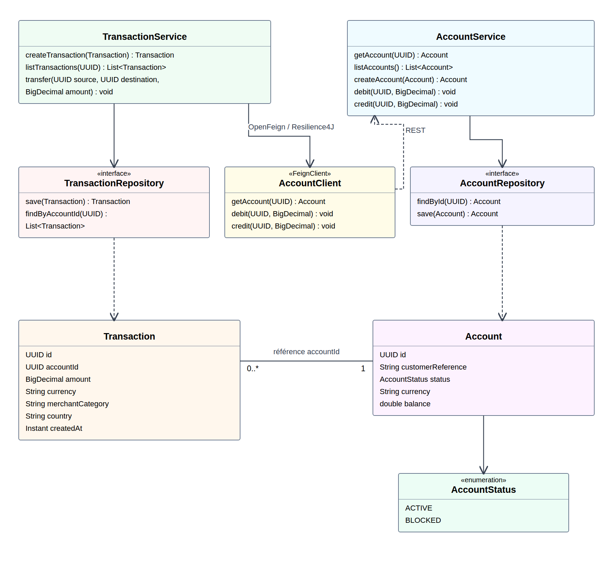

### 2. Schéma d’architecture

Le client Angular passe par la gateway pour accéder aux services. `transaction-service` communique avec `account-service` avec OpenFeign et Resilience4J pour vérifier le compte et mettre à jour son solde.

Chaque service métier expose REST, GraphQL et MCP. Ces trois interfaces utilisent la même couche service pour appliquer les règles métier : montant positif, plafond, compte actif et devise identique.

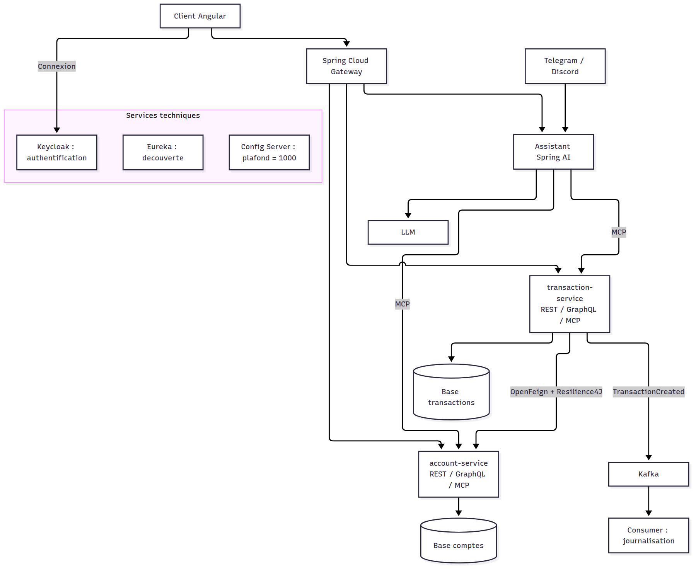

Les autres composants ont les rôles suivants :

- **Eureka** : découvrir les microservices.
- **Config Server** : partager le plafond `bank.transaction.max-amount=1000`.
- **Keycloak** : gérer l’authentification et les autorisations.
- **Spring AI** : permettre au chatbot d’utiliser les outils MCP des services, depuis le web, Telegram ou Discord.
- **Kafka** : recevoir un événement après l’enregistrement d’une transaction dans `bank.transactions.created`, avec `accountId` comme clé. Le consumer journalise uniquement l’événement.

Un virement doit vérifier les deux comptes avant de débiter la source et de créditer la destination. Il faudra gérer les échecs pour éviter une mise à jour partielle des soldes.

L’expérimentation Python de détection de fraude sera réalisée séparément, sans intégration aux microservices. Docker Compose et GitHub Actions seront traités dans la partie DevOps.

Les diagrammes représentent la conception prévue.

### Images des diagrammes

Les diagrammes sont disponibles au format PNG dans [conception/](conception/) et une copie est conservée dans `images/`.

## Partie C - Microservices fonctionnels

### 1. Initialisation du projet

Le projet Maven parent `adria-bank` regroupe les modules. Le premier module est `account-service`, configuré avec Java 21, Spring Boot 4.0.8, Spring Web MVC, Spring Data JPA et H2, comme dans le projet exemple.

Le service utilise le port `8056` et une base H2 en mémoire `accounts-db`. Les captures suivantes retracent son initialisation avant l’ajout des entités et des connecteurs.

Compilation depuis la racine :

```bash
bash mvnw compile
```

Le POM parent déclare le module `account-service` :

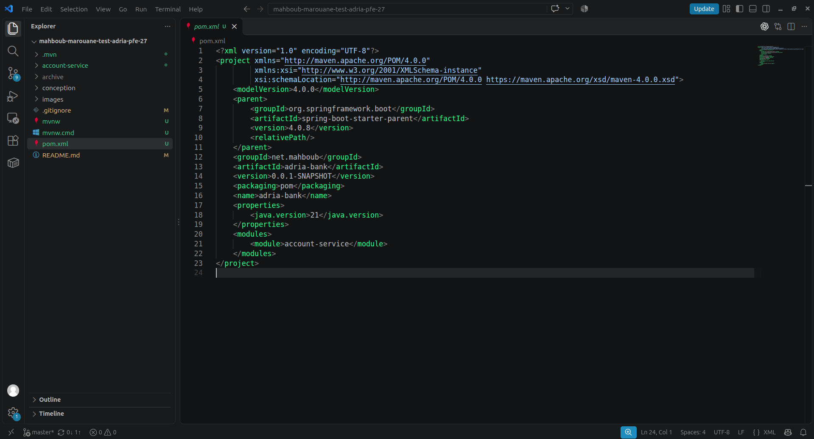

La commande `bash mvnw compile` compile le parent et le module avec succès :

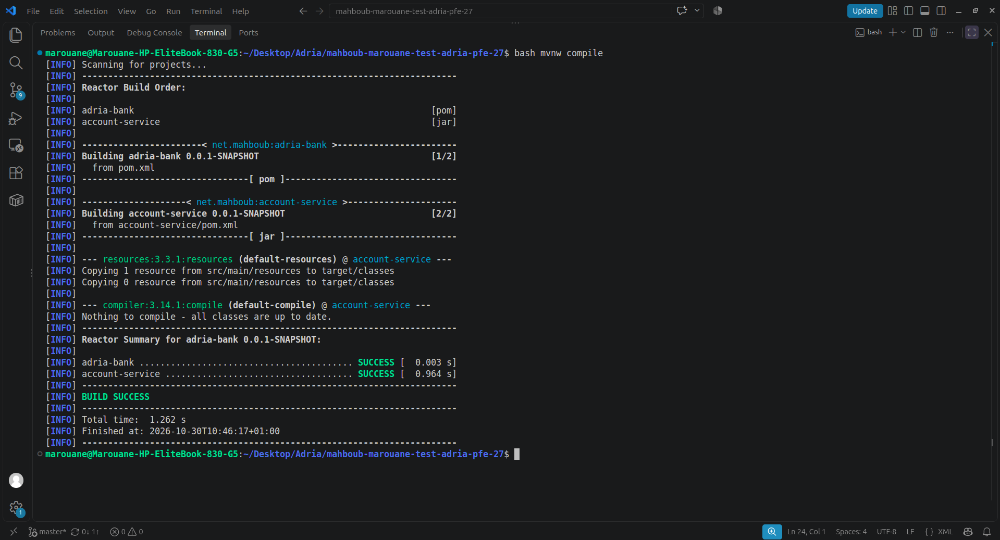

### 2. Entité Account et repository

L’entité `Account` contient les champs demandés : `id` de type UUID, `customerReference`, `status`, `currency` et `balance`. L’identifiant est généré automatiquement. L’état du compte est enregistré en texte (`ACTIVE` ou `BLOCKED`) avec l’énumération `AccountStatus`.

`AccountRepository` hérite de `JpaRepository<Account, UUID>` pour enregistrer et consulter les comptes. Les classes métier se trouvent dans `domain/` et le repository dans `repository/`. Lombok génère les accesseurs, les constructeurs et le builder, comme dans le projet exemple.

Entité `Account` :

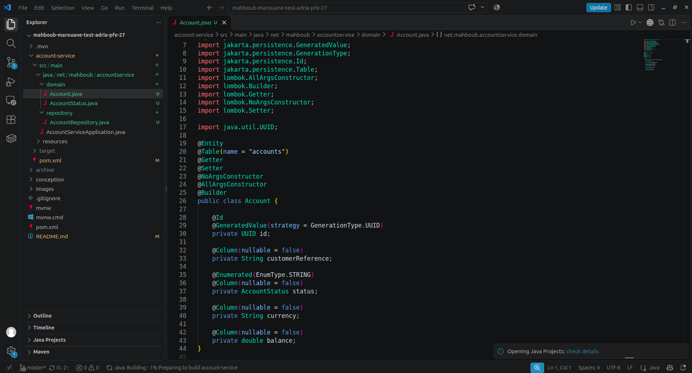

Interface `AccountRepository` :

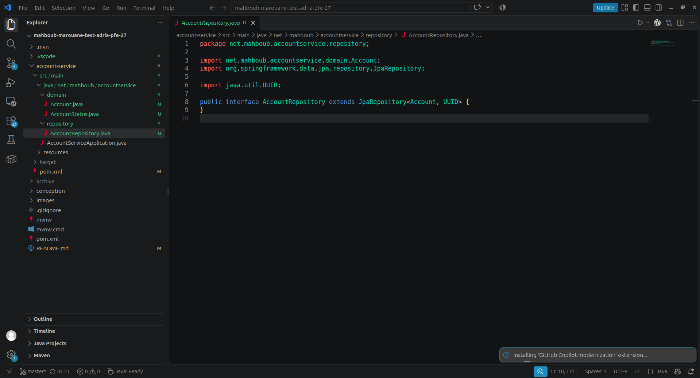

La compilation après l’ajout de l’entité et du repository se termine avec `BUILD SUCCESS` :

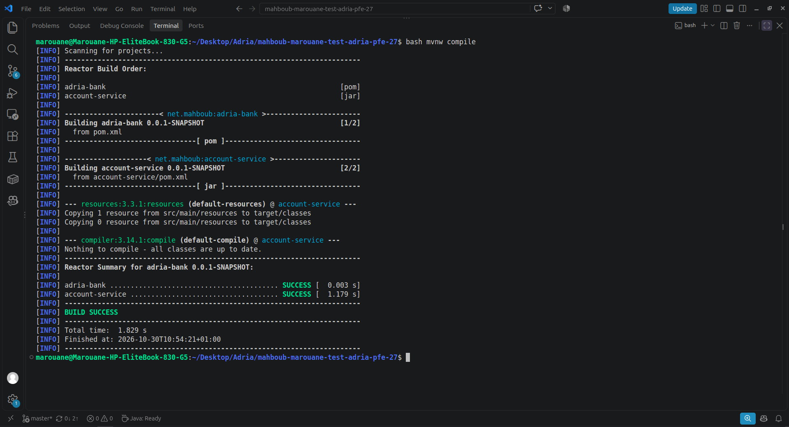

### 3. Couche service et API REST des comptes

`AccountService` permet de créer un compte, de consulter un compte par UUID et de lister les comptes. `AccountRestController` délègue ces opérations au service.

| Méthode | URL | Résultat |
| --- | --- | --- |
| POST | `/accounts` | Création du compte, réponse 201 avec UUID généré |
| GET | `/accounts` | Liste des comptes, réponse 200 |
| GET | `/accounts/{id}` | Compte demandé, réponse 200 ou 404 s’il n’existe pas |

La création utilise `CreateAccountRequest`, sans identifiant fourni par le client. La référence client est obligatoire, l’état doit être renseigné, la devise doit comporter trois lettres majuscules et le solde initial doit être positif ou nul. Une requête invalide reçoit une réponse 400. La validation est également appliquée à l’entrée de la couche service pour les futurs connecteurs GraphQL et MCP.

Swagger UI est disponible à l’adresse : http://localhost:8056/swagger-ui/index.html.

Exemple de création :

```json
{
  "customerReference": "CLIENT-001",
  "status": "ACTIVE",
  "currency": "MAD",
  "balance": 2500
}
```

Les tests d’intégration vérifient la création et la lecture, les erreurs 404/400 et le refus des données invalides sans enregistrement. Résultat de `bash mvnw test` : 3 tests réussis, aucune erreur.

Pour démarrer le service depuis la racine :

```bash
bash mvnw -pl account-service spring-boot:run
```

Les comptes sont stockés dans H2 en mémoire : ils sont perdus à l’arrêt du service.

#### Tests dans Swagger UI

Création du compte `CLIENT-001` avec un solde de 2500 MAD : réponse 201 avec un UUID généré.

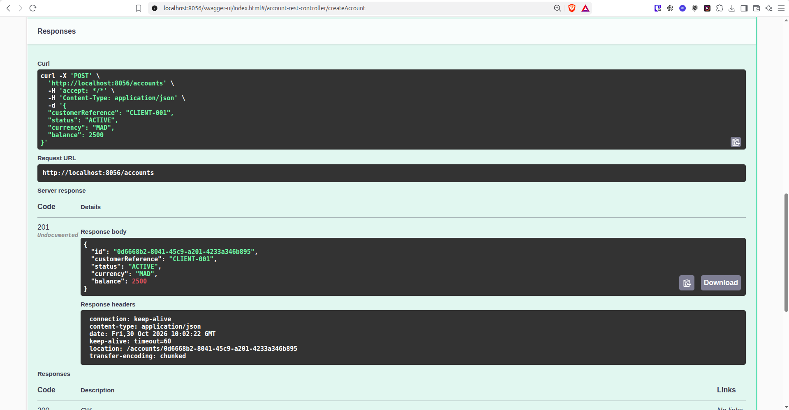

Consultation de la liste des comptes : réponse 200 contenant le compte créé.

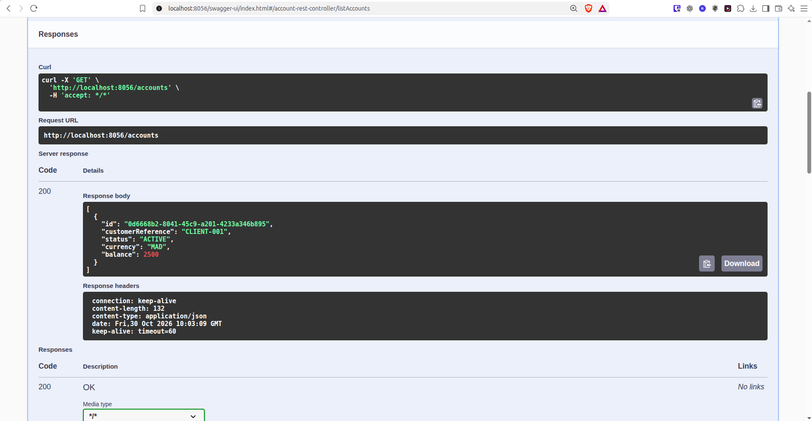

Consultation du compte avec son UUID : réponse 200 avec les mêmes informations.

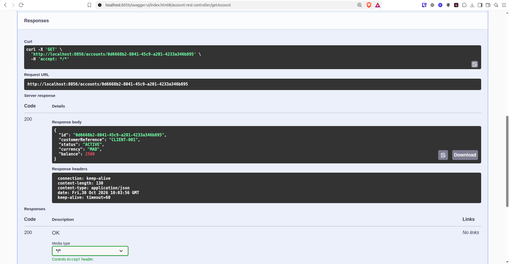

Consultation d’un UUID inexistant : réponse 404 avec le message « Compte introuvable ».

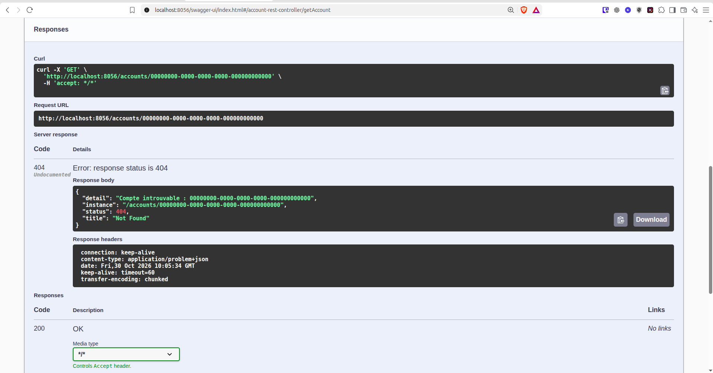

Tentative de création avec un solde initial de -500 : la requête est refusée avec une réponse 400.

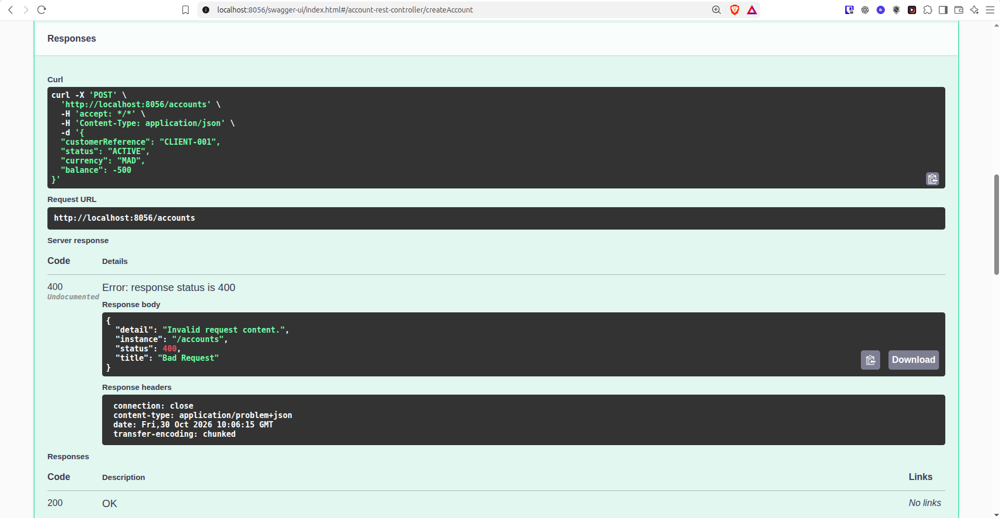

### 4. Connecteur GraphQL des comptes

Le schéma `graphql/schema.graphqls` expose les requêtes `accounts`, `account(id)` et la mutation `createAccount(input)`. Le contrôleur dans `web/graphql/` appelle le même `AccountService` que REST.

GraphiQL : http://localhost:8056/graphiql. L’endpoint HTTP est `/graphql`.

Création d’un compte :

```graphql
mutation {
  createAccount(input: {
    customerReference: "CLIENT-GQL"
    status: ACTIVE
    currency: "MAD"
    balance: 1500
  }) {
    id
    customerReference
    status
    currency
    balance
  }
}
```

Liste des comptes :

```graphql
query {
  accounts {
    id
    customerReference
    status
    currency
    balance
  }
}
```

Consultation par UUID (remplacer `UUID_DU_COMPTE` par l’identifiant retourné à la création) :

```graphql
query {
  account(id: "UUID_DU_COMPTE") {
    id
    customerReference
    status
    currency
    balance
  }
}
```

Pour un compte inexistant, utiliser `00000000-0000-0000-0000-000000000000` : la réponse contient `account: null` et une erreur `NOT_FOUND`. Pour vérifier la validation, reprendre la mutation avec `balance: -100` : une erreur `BAD_REQUEST` est retournée, sans création de compte.

Contrairement aux réponses REST 404/400, ces erreurs d’exécution GraphQL sont présentes dans le champ `errors` du JSON avec une réponse HTTP 200.

Validation : `bash mvnw test` exécute 7 tests réussis (3 REST et 4 GraphQL). Les tests GraphQL couvrent la création, la liste, la consultation, la lecture par REST, le compte inexistant et les données invalides.

Création du compte `CLIENT-GQL` avec un solde de 1500 MAD depuis GraphiQL :

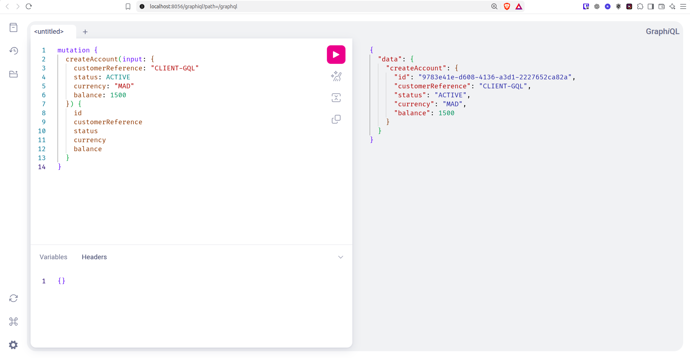

Consultation de la liste des comptes depuis GraphiQL :

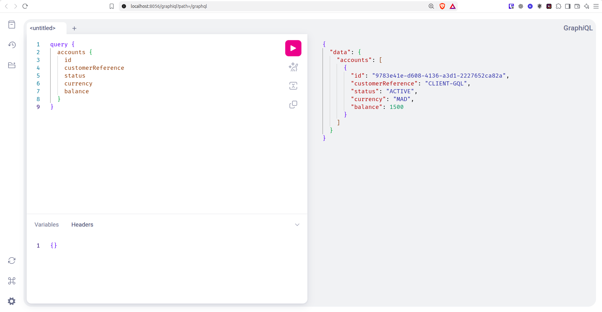

Consultation du compte créé par son UUID :

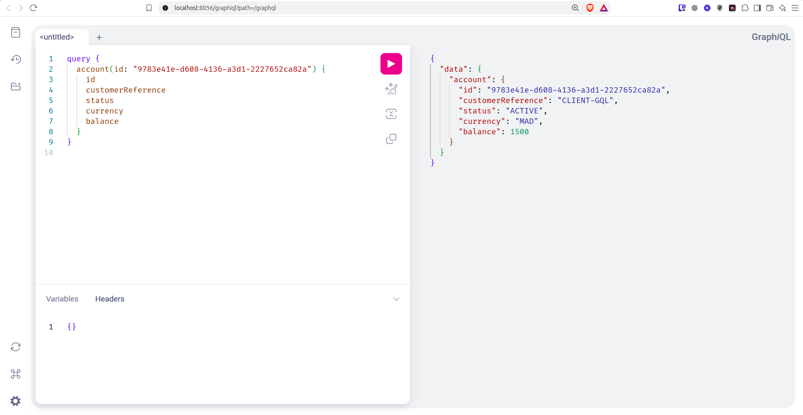

Recherche d’un compte inexistant : `account` vaut `null` et l’erreur est classée `NOT_FOUND`.

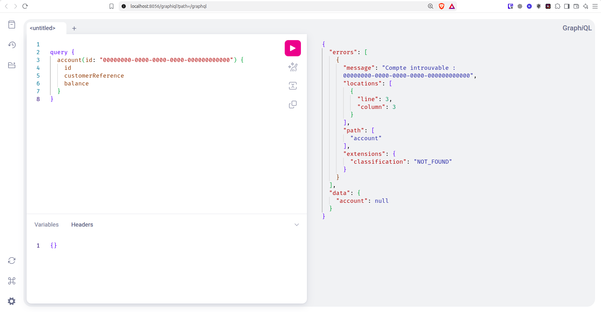

Création avec un solde négatif : la mutation est refusée avec l’erreur `BAD_REQUEST`.

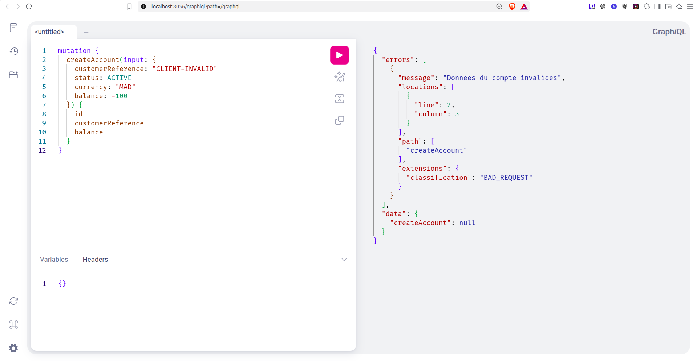

### 5. Connecteur MCP des comptes

`AccountMcpTools`, dans le package `mcp/`, expose trois outils avec Spring AI 2.0.1 :

| Outil | Paramètres | Opération |
| --- | --- | --- |
| `list_accounts` | Aucun | Lister les comptes |
| `get_account` | `id` | Consulter un compte par UUID |
| `create_account` | `request` | Créer un compte |

Les outils appellent le même `AccountService` que REST et GraphQL. La validation du solde initial reste donc identique pour les trois connecteurs.

Le serveur utilise le transport **Streamable HTTP** à l’adresse `http://localhost:8056/mcp`. Les annotations `@McpTool` et `@McpToolParam` décrivent les outils et leurs paramètres.

Pour ouvrir MCP Inspector :

```bash
npx @modelcontextprotocol/inspector
```

Ouvrir l’adresse affichée dans le terminal, sélectionner le transport Streamable HTTP et connecter le serveur `http://localhost:8056/mcp`.

Paramètres de `create_account` :

```json
{
  "request": {
    "customerReference": "CLIENT-MCP",
    "status": "ACTIVE",
    "currency": "MAD",
    "balance": 2000
  }
}
```

Vérifications effectuées sur le serveur : découverte des trois outils, création, consultation par UUID, liste, refus d’un solde négatif et erreur pour un compte inexistant. Les erreurs d’exécution des outils sont signalées par `isError: true`. Les 7 tests REST/GraphQL passent également après l’ajout de MCP.

Création du compte `CLIENT-MCP` avec un solde de 2000 MAD dans MCP Inspector :

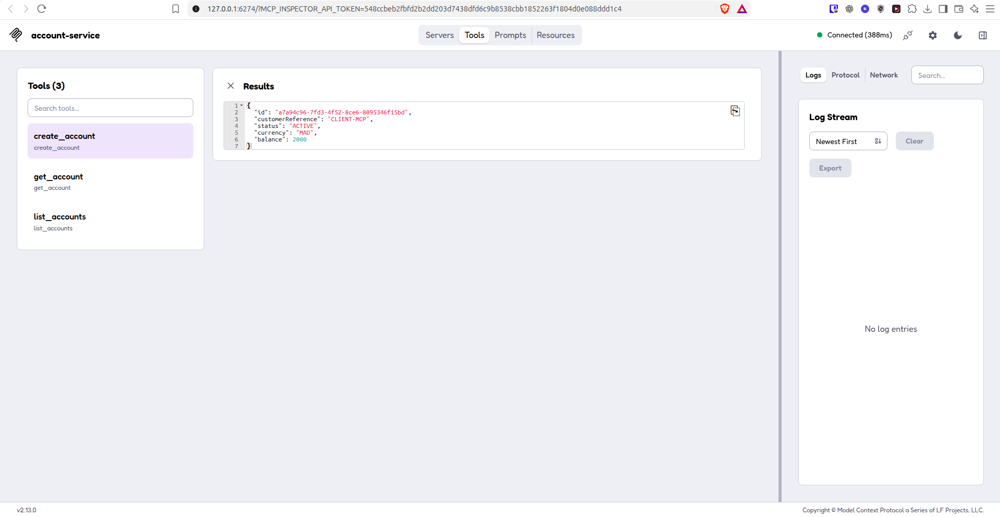

Consultation du compte `CLIENT-MCP` par UUID dans MCP Inspector :

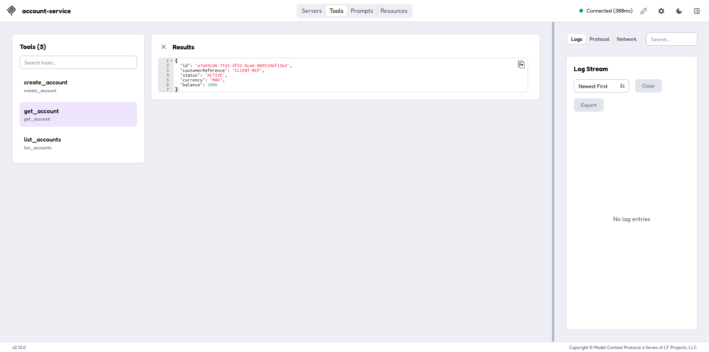

### 6. Initialisation de transaction-service

Le module `transaction-service` est ajouté au POM parent. Il utilisera le port 8057 et une base H2 distincte `transactions-db`.

L’entité `BankTransaction` contient un UUID généré, `accountId`, un montant `BigDecimal`, la devise, la catégorie du commerçant, le pays et la date `Instant`. `TransactionRepository` permet de consulter les transactions d’un compte avec `findByAccountId`.

Le serveur MCP de ce module était désactivé pendant cette initialisation ; les opérations métier et les connecteurs présentés ci-dessous ont ensuite été ajoutés.

Compilation du parent et des deux modules :

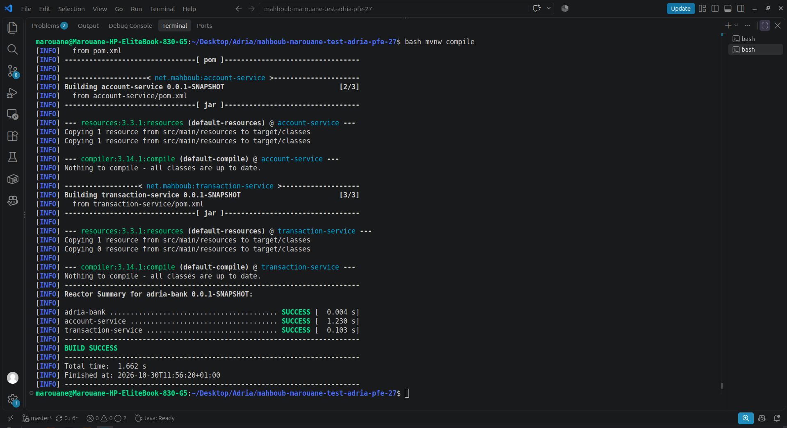

### 7. Transactions REST, OpenFeign et Resilience4J

`POST /transactions` enregistre un débit après vérification du montant, du plafond, de l’existence du compte, de son état `ACTIVE`, de la devise et du solde disponible. `GET /transactions` liste les opérations ; le paramètre facultatif `accountId` filtre par compte.

`AccountClient` utilise OpenFeign pour consulter le compte et appeler `POST /accounts/{id}/debit`. Le service comptes verrouille la ligne pendant le débit et revérifie le solde, l’état et la devise avant la mise à jour.

Le plafond était initialement local. Il est maintenant partagé par Config Server avec `bank.transaction.max-amount=1000`, comme présenté dans la partie D.

`AccountGateway` protège les appels avec un circuit breaker Resilience4J : fenêtre de 5 appels, minimum 3 appels, seuil d’échec 50 %, ouverture pendant 10 secondes. Les délais OpenFeign sont de 2 secondes pour la connexion et 3 secondes pour la lecture. Aucun retry automatique n’est effectué sur les écritures. Une indisponibilité produit une réponse 503, sans inventer de solde ni accepter l’opération par défaut.

Swagger transactions : http://localhost:8057/swagger-ui/index.html.

```json
{
  "accountId": "UUID_DU_COMPTE",
  "amount": 250,
  "currency": "MAD",
  "merchantCategory": "SHOPPING",
  "country": "MA"
}
```

Validation : 14 tests réussis (8 comptes et 6 transactions). Les tests couvrent notamment les refus métier, le débit et l’ouverture du circuit breaker. Un test sur les deux services démarrés a confirmé une transaction de 250 MAD, un solde passant de 2500 à 2250, ainsi que le refus du dépassement de plafond, du montant nul, d’une autre devise et d’un compte inexistant.

À ce stade, la transaction locale est annulée si l’appel de débit échoue. Les deux bases ne partagent cependant pas une transaction atomique : si le débit distant réussit mais que sa réponse est perdue ou que le commit local échoue, une réconciliation est nécessaire. La réponse 503 ne garantit donc pas l’absence de débit. L’idempotence et la compensation restent à traiter pour fiabiliser ce scénario.

Création d’une transaction de 250 MAD :

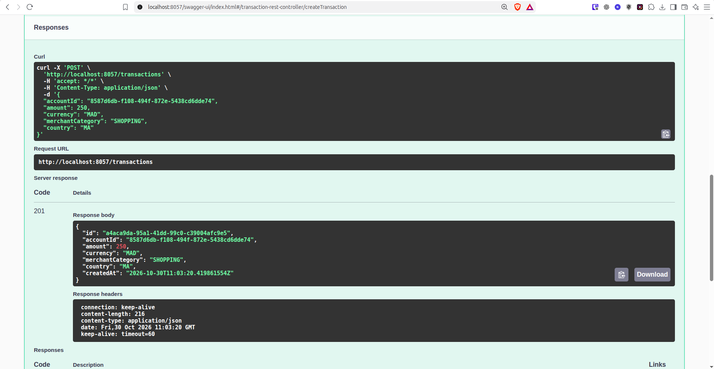

Le compte passe de 2500 à 2250 MAD après le débit :

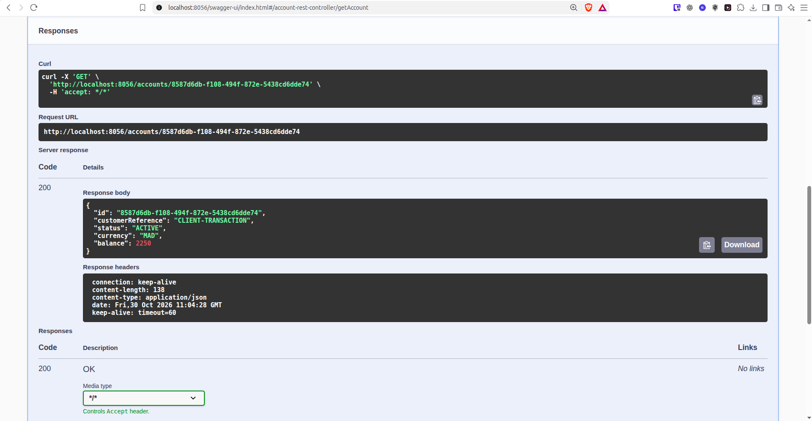

Une transaction de 1500 est refusée car elle dépasse le plafond de 1000 :

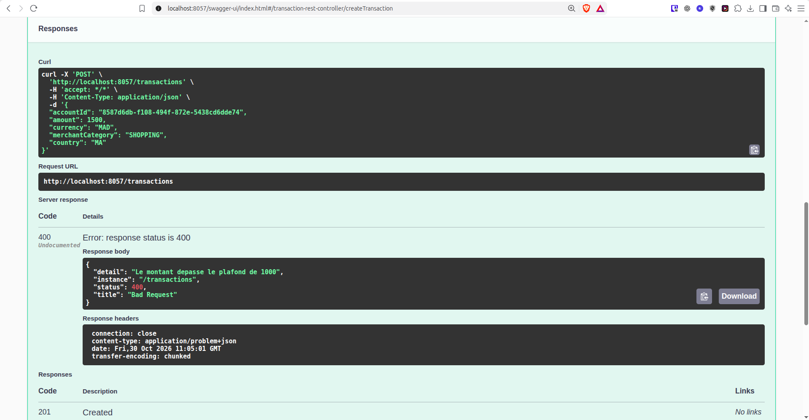

### 8. GraphQL et MCP des transactions

`TransactionGraphqlController` et `TransactionMcpTools` appellent le même `TransactionService` que REST. La vérification du plafond, du compte, de la devise et du solde est donc commune aux trois connecteurs.

GraphiQL transactions : http://localhost:8057/graphiql.

```graphql
mutation {
  createTransaction(input: {
    accountId: "UUID_DU_COMPTE"
    amount: 100
    currency: "MAD"
    merchantCategory: "SHOPPING"
    country: "MA"
  }) {
    id
    accountId
    amount
    currency
    createdAt
  }
}
```

```graphql
query {
  transactions {
    id
    accountId
    amount
    currency
    createdAt
  }
}
```

La requête accepte aussi `transactions(accountId: "UUID_DU_COMPTE")`. Le schéma utilise `Float` pour le montant à l’interface GraphQL et `BigDecimal` côté Java ; un scalaire décimal serait préférable pour une précision monétaire exacte de bout en bout.

Le serveur MCP transactions est disponible sur `http://localhost:8057/mcp` avec les outils `create_transaction`, `list_transactions` et `get_account_transactions`.

Paramètres JSON de `create_transaction` dans MCP Inspector :

```json
{
  "request": {
    "accountId": "UUID_DU_COMPTE",
    "amount": 50,
    "currency": "MAD",
    "merchantCategory": "SHOPPING",
    "country": "MA"
  }
}
```

Validation : 17 tests réussis sur les deux modules. Les tests des connecteurs transactions vérifient la création GraphQL, la lecture par REST, le rejet des montants invalides et le rollback local si le débit distant échoue.

Création d’une transaction depuis GraphiQL :

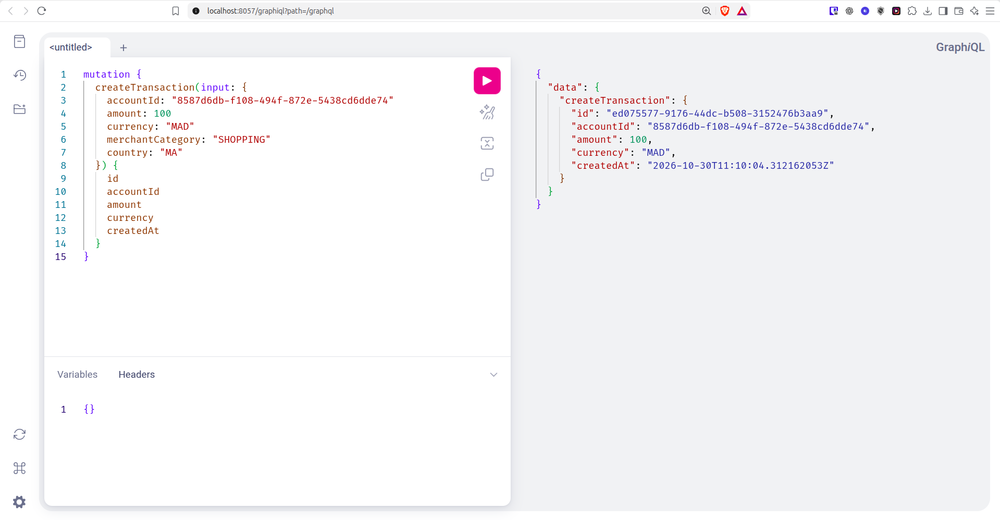

Consultation des transactions depuis MCP Inspector :

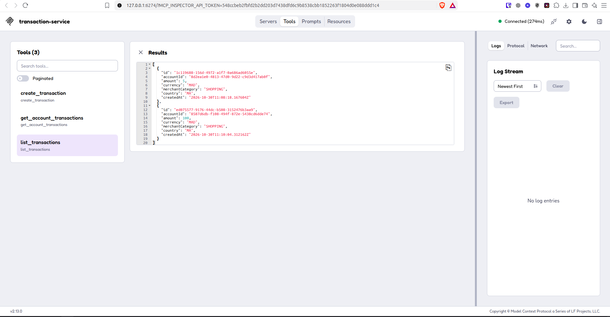

### 9. Virement entre comptes

Le virement est exposé par `POST /transactions/transfer`, la mutation GraphQL `transfer(input)` et l’outil MCP `transfer_money`.

```json
{
  "sourceAccountId": "UUID_SOURCE",
  "destinationAccountId": "UUID_DESTINATION",
  "amount": 100,
  "currency": "MAD"
}
```

Les comptes doivent être distincts, actifs et de même devise. Le montant doit être positif, inférieur ou égal au plafond partagé et couvert par le solde source.

Le service comptes verrouille les deux lignes dans un ordre stable et applique le débit et le crédit dans une seule transaction locale. Le service transactions enregistre deux écritures liées par `transferId`, avec les directions `DEBIT` et `CREDIT`. La catégorie `TRANSFER` et le pays `N/A` identifient ces écritures internes.

L’atomicité des deux soldes est assurée dans la base comptes. La cohérence entre cette base et la base transactions conserve la limite distribuée décrite plus haut : une réponse perdue ou un échec du commit transactions après le virement distant exige une réconciliation. Aucun retry automatique n’est appliqué.

Vérification du virement sur les services démarrés : 100 MAD transférés, soldes 2500/500 devenus 2400/600. Les virements vers le même compte, au-dessus du plafond et vers un compte bloqué sont refusés. Le refus vers un compte bloqué conserve le solde source.


## Partie D - Microservices techniques

### 1. Eureka Discovery

Le module `discovery-service` utilise `@EnableEurekaServer` et écoute sur le port 8761. Les services comptes, transactions, gateway et configuration s’y enregistrent.

Console Eureka : http://localhost:8761.

### 2. Config Server

Le module `config-service` utilise `@EnableConfigServer` et écoute sur le port 8888. Le profil `native` lit les fichiers locaux de `src/main/resources/config-repo/`.

Le fichier partagé `application.properties` contient :

```properties
bank.transaction.max-amount=1000
```

La configuration d’une application se consulte avec http://localhost:8888/transaction-service/default. Les clients chargent cette configuration au démarrage avec `spring.config.import`. Le service transactions n’a plus de valeur locale du plafond.

L’URL du serveur de configuration peut être fournie par `CONFIG_SERVER_URL` et celle d’Eureka par `EUREKA_URL`. Les secrets restent dans l’environnement, séparés du dépôt de configuration. Les changements du fichier partagé nécessitent ici une reconstruction de Config Server et un redémarrage des clients.

### 3. Spring Cloud Gateway

Le module `gateway-service` écoute sur le port 9999. Les routes utilisent `lb://account-service` et `lb://transaction-service` : les adresses des instances sont obtenues depuis Eureka.

| URL gateway | Destination |
| --- | --- |
| `/accounts` et `/accounts/**` | REST comptes |
| `/transactions` et `/transactions/**` | REST transactions |
| `/account/graphql` | GraphQL comptes |
| `/transaction/graphql` | GraphQL transactions |
| `/account/mcp` | MCP comptes |
| `/transaction/mcp` | MCP transactions |

OpenFeign utilise également le nom `account-service` et Spring Cloud LoadBalancer pour découvrir le service comptes. Une URL explicite reste possible avec la propriété `bank.account-service.url`.

### Démarrage local

Construire les modules avec Java 21 :

```bash
bash mvnw -DskipTests package
```

Démarrer chaque commande dans un terminal distinct, depuis la racine, dans cet ordre :

```bash
java -jar discovery-service/target/discovery-service-0.0.1-SNAPSHOT.jar
java -jar config-service/target/config-service-0.0.1-SNAPSHOT.jar
java -jar account-service/target/account-service-0.0.1-SNAPSHOT.jar
java -jar transaction-service/target/transaction-service-0.0.1-SNAPSHOT.jar
java -jar gateway-service/target/gateway-service-0.0.1-SNAPSHOT.jar
```

Attendre que Config Server soit disponible avant de démarrer les clients. Le registre Eureka et les routes peuvent prendre quelques dizaines de secondes pour se mettre à jour. Les services métier utilisent H2 en mémoire : leurs données sont perdues au redémarrage.

Chaque service expose `/actuator/health` pour vérifier son démarrage.

### Vérification de la Partie D

- Construction des cinq services avec `bash mvnw -DskipTests package` : `BUILD SUCCESS`.
- Les cinq endpoints `/actuator/health` répondent `UP`.
- Eureka affiche `ACCOUNT-SERVICE`, `TRANSACTION-SERVICE`, `GATEWAY-SERVICE` et `CONFIG-SERVICE` avec l’état `UP`.
- Les URL `http://localhost:9999/accounts` et `http://localhost:9999/transactions` répondent 200.
- Un compte créé par la gateway avec 2500 MAD passe à 2250 MAD après une transaction de 250 MAD, avec l’appel OpenFeign résolu par Eureka.
- Une transaction de 1500 est refusée avec le plafond partagé de 1000 chargé depuis Config Server.
- Les deux routes GraphQL via la gateway répondent correctement.

La vérification de cette étape porte sur la construction et le fonctionnement des services démarrés ; la suite complète de tests n’a pas été relancée pour cette partie.

Les quatre applications clientes sont enregistrées dans Eureka avec l’état `UP` :

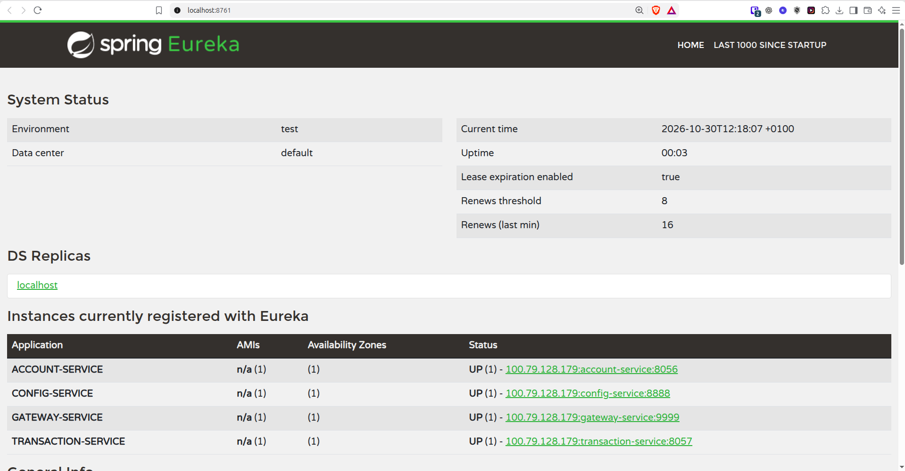

Config Server fournit le plafond partagé de 1000 au service transactions :

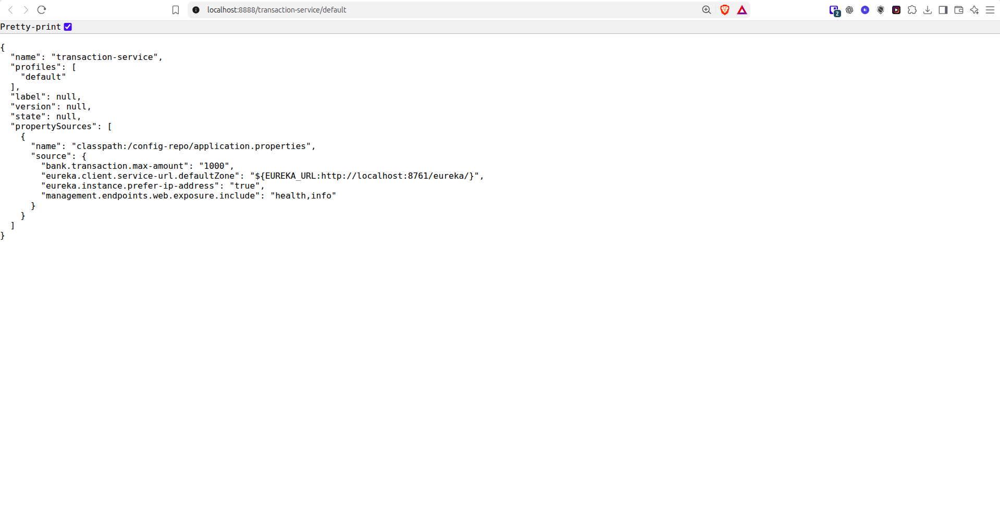

Consultation des comptes par la gateway sur le port 9999 :

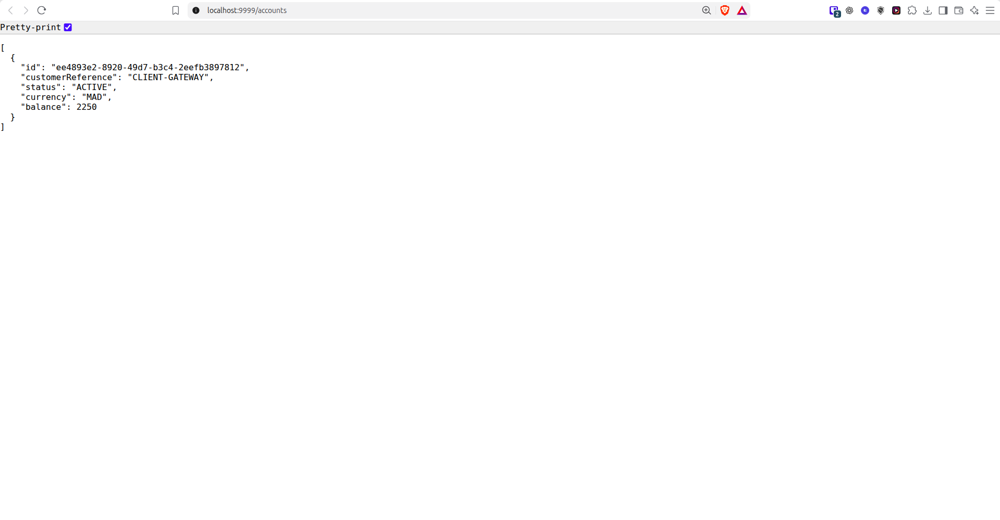

## Partie E - Assistant bancaire Spring AI

Le module `ebank-bot` expose un chatbot REST sur le port 8058. Il utilise Spring AI avec le modèle Groq `openai/gpt-oss-120b`. Son client MCP se connecte aux serveurs comptes et transactions afin de consulter les données et d’exécuter les opérations explicitement demandées.

Le chatbot utilise les outils MCP, sans accès direct aux repositories. Il ne doit pas inventer de comptes, d’UUID ou de soldes, ni répéter automatiquement une écriture en erreur. Chaque requête est indépendante, sans mémoire de conversation partagée.

La clé `GROQ_API_KEY` est chargée depuis l’environnement ou le fichier `.env` local ignoré par Git. Le chatbot est exposé uniquement par REST, sans dépendance Telegram ou Discord.

Démarrer le bot depuis la racine, après les serveurs MCP :

```bash
java -Djava.net.preferIPv4Stack=true -jar ebank-bot/target/ebank-bot-0.0.1-SNAPSHOT.jar
```

Swagger : http://localhost:8058/swagger-ui/index.html.

Endpoint direct : `POST http://localhost:8058/chat`. Via la gateway : `POST http://localhost:9999/chat`.

```json
{
  "query": "Liste les comptes bancaires avec leurs references clients, UUID et soldes."
}
```

La réponse JSON contient le champ `answer`. La disponibilité du fournisseur Groq et une clé valide sont nécessaires pour produire la réponse du LLM.


Vérification REST de l’assistant : `POST /chat` a répondu 200 avec les références, UUID et soldes réels renvoyés par les outils MCP (SOURCE-VIREMENT : 2400 MAD, DESTINATION-VIREMENT : 600 MAD). Le modèle utilise `reasoning_format=hidden` afin d’éviter le renvoi d’un champ de raisonnement non accepté par Groq lors des appels d’outils.

Test du chatbot dans Swagger : la réponse 200 contient les comptes et les soldes obtenus avec les outils MCP.

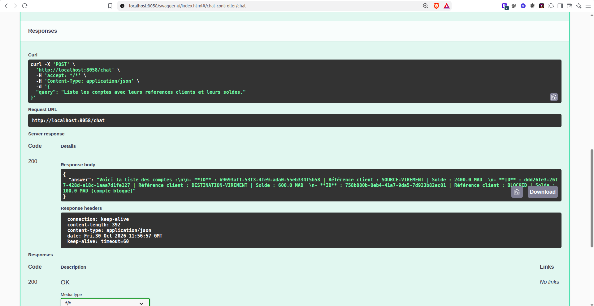

## Avancement et parties restantes

Les parties B, C et D sont développées. L’assistant de la partie E répond par REST avec les outils MCP ; sa capture de test est intégrée au rapport. Les intégrations Telegram et Discord ne sont pas retenues.

Les parties suivantes restent à développer : communication Kafka et consumer (F), client web ou mobile (G), détection de fraude Python (H), Docker Compose et pipeline CI/CD (I). Keycloak figure dans l’architecture cible, mais n’est pas encore intégré. Le rapport est une version intermédiaire qui sera complétée avec ces réalisations.
